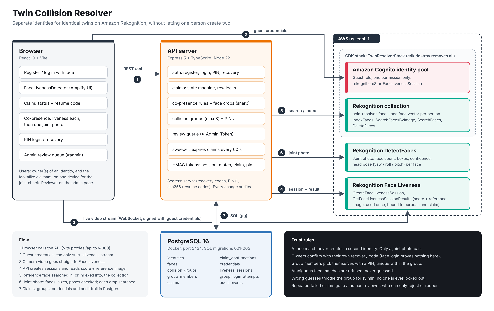
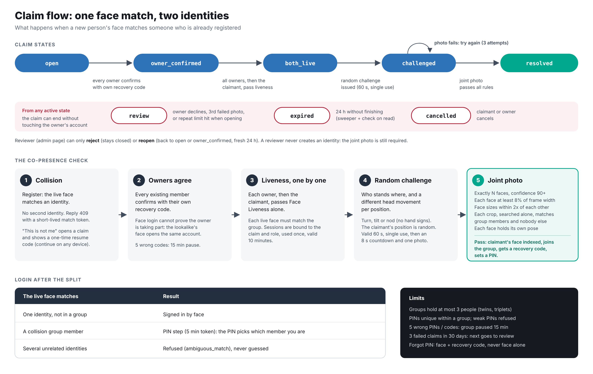

# Twin Collision Resolver

Give identical twins (and other lookalikes) their own identities on Amazon Rekognition face login, without letting one person create two.

Face recognition can't tell identical twins apart. If you just lower the match threshold, one person can register twice. If you keep it strict, the second twin can never register at all. This project resolves that collision with one rule:

> **Faces can't prove that two people exist. Two live faces in the same frame can.**



## How it works

1. **Collision.** At registration the live face (Rekognition Face Liveness) is searched in the collection. If it matches an existing identity, no new identity is created. The newcomer can open a claim instead and gets a one-time resume code.
2. **Owners agree.** Every existing member of that identity or group confirms with their **own recovery code**. Face login proves nothing here, because the lookalike's face opens the same account.
3. **Liveness, one by one.** Each owner, then the claimant, passes Face Liveness on the claim device. Every live face must match the group.
4. **Random challenge.** The server picks who stands where and a different head movement per position (turn, tilt, nod). The challenge is valid for 60 s and can be used once.
5. **Joint photo.** One photo, then server-side rules:
   - exactly N faces, each at least 8% of the frame width
   - face sizes within 2x of each other
   - each face, cropped and searched alone, matches group members and nobody else
   - each face holds its assigned pose
6. **Pass.** The claimant's face is indexed, they join a collision group (max 3), get a recovery code and set a PIN. From then on, a face that matches the group has to be followed by the member's PIN.



### Login after the split

| The live face matches | Result |
| --- | --- |
| one identity, not in a group | signed in by face |
| a collision group member | `pin_required`: the PIN picks the member |
| several unrelated identities | refused (`ambiguous_match`), never guessed |

### Design decisions

- **The claim is a state machine with row locks.** Every transition locks the claim row and checks the allowed from-states, so two racing requests can't both succeed.
- **One active claim per identity or group**, enforced by a partial unique index. Claims expire after 24 h (a sweeper, plus a check on every read).
- **Throttle, never lockout.** 5 wrong PINs or recovery codes pause the group's PIN logins for 15 minutes. One member's guesses never lock another member out.
- **A face alone never resets anything.** A forgotten PIN needs face + recovery code, and the code is rotated after use.
- **The repeat limit.** After 3 failed claims (cancelled, expired or review) against the same target in 30 days, the next claim goes to manual review.
- **Humans can't mint identities.** A reviewer can only reject or reopen a claim; the joint photo is still required.
- **Least-privilege browser access.** The Cognito guest role can only call `rekognition:StartFaceLivenessSession`. Everything else goes through the API.
- **Everything is audited.** Each state change, confirmation, attempt and decision goes to `audit_events` and shows up in the review queue.

## Stack

| Folder | What |
| --- | --- |
| `infra/` | AWS CDK (TypeScript): Rekognition collection, Cognito identity pool with the guest role. `cdk destroy` removes it all. |
| `server/` | Express 5 + TypeScript on Node 22, PostgreSQL via `pg`, AWS SDK v3, `sharp` for face crops, plain SQL migrations |
| `client/` | React 19 + Vite, Amplify UI `FaceLivenessDetector` |
| `docker-compose.yml` | PostgreSQL 16 on port 5434 |

## Quick start

Needs Node 22+, Docker and an AWS profile with Rekognition access. Everything runs in `us-east-1`.

```bash
npm run install:all
npm run db:up                         # postgres:16 on localhost:5434
(cd infra && npx cdk bootstrap)       # first CDK deploy in this account/region only
npm run infra:deploy                  # writes infra/cdk-outputs.json
cp server/.env.example server/.env    # set AWS_PROFILE, TOKEN_SECRET, ADMIN_TOKEN
npm run server:dev                    # runs migrations, listens on :4000
npm run client:dev                    # http://localhost:5173 (proxies /api to :4000)
```

To try a collision with only one person, lower the threshold (for example `FACE_MATCH_THRESHOLD=60`) and register twice from two browsers. The admin review queue is at http://localhost:5173/#admin (it uses `ADMIN_TOKEN`).

## Tests

```bash
npm --prefix server test
```

The suite has 132 checks in 5 suites: co-presence rules (24), claims (21), co-presence (31), PINs (35) and hardening (21). Each suite runs against its own Postgres database. Rekognition is replaced by a scripted fake, so the tests make no AWS calls and can cover the 2- and 3-person pass paths.

## API

| Method | Path | Auth | Does |
| --- | --- | --- | --- |
| POST | /liveness/sessions | none | `{purpose}` -> Face Liveness session |
| POST | /register | none | `{sessionId, displayName}` -> identity + recovery code, or 409 + `matchToken` |
| POST | /login | none | `{sessionId}` -> session, or `pin_required` + `pinToken` |
| POST | /login/pin | pin token | `{pinToken, pin}` -> session |
| POST | /login/recovery | pin token | `{pinToken, recoveryCode, newPin}` -> session + new recovery code |
| GET | /me | session | identity, `hasPin`, `needsPin` |
| POST | /me/pin | session | set or change PIN |
| POST | /claims | match token | open a claim -> `claimToken`, `resumeCode` |
| POST | /claims/resume | none | `{resumeCode}` -> new claim token |
| GET | /claims/:id | claim token or owner | state, next step, owner confirmations |
| DELETE | /claims/:id | claim token | claimant cancels |
| GET | /me/claims | session | active claims against me |
| POST | /claims/:id/owner-confirm | session + recovery code | owner confirms |
| POST | /claims/:id/owner-decline | session | send to review |
| POST | /claims/:id/owner-cancel | session | owner cancels |
| GET | /claims/:id/liveness | claim token | who has passed liveness |
| POST | /claims/:id/liveness-session | claim token | `{role}` -> session bound to claim + role |
| POST | /claims/:id/liveness | claim token | `{role, sessionId}` -> spend it |
| POST | /claims/:id/challenge | claim token | random positions + poses (60 s, single use) |
| POST | /claims/:id/joint-capture | claim token | `{image}` -> pass (identity, recovery code) or fail (reasons, attempts left) |
| GET | /admin/review-queue | `X-Admin-Token` | claims waiting for a decision + audit trail |
| POST | /admin/claims/:id/decision | `X-Admin-Token` | `{decision: "reject" or "reopen"}` |

## Known limits

- The joint photo is a webcam still with random poses, not AWS's anti-spoof model. A good video replay or a mask could beat it.
- Liveness sessions aren't bound to specific faces in the joint photo, because the people look alike and can't be told apart.
- If an owner can't or won't take part, nothing can be proven automatically. The claim goes to review and the owner's account is unaffected.
- One member can pause the group's PIN logins for up to 15 minutes with wrong guesses (a throttle, never a lockout).
- This is a learning build: it runs locally against real AWS, with no deployment of the API or client.

## Build log

| Step | What |
| --- | --- |
| 1 | CDK infra, Postgres, server skeleton, schema |
| 2 | Register and login with Face Liveness, React client |
| 3 | Claims: state machine, expiry, owner confirm with recovery code |
| 4 | Co-presence: per-person liveness, random challenge, joint-photo rules |
| 5 | Collision groups, PINs, PIN login and recovery |
| 6 | Hardening: third lookalike, repeat-claim limit, resume codes, admin review queue |

## Tear down

```bash
npm run infra:destroy   # deletes the collection (and every indexed face), identity pool and role
npm run db:down         # or: npm run db:reset to wipe the data
```
